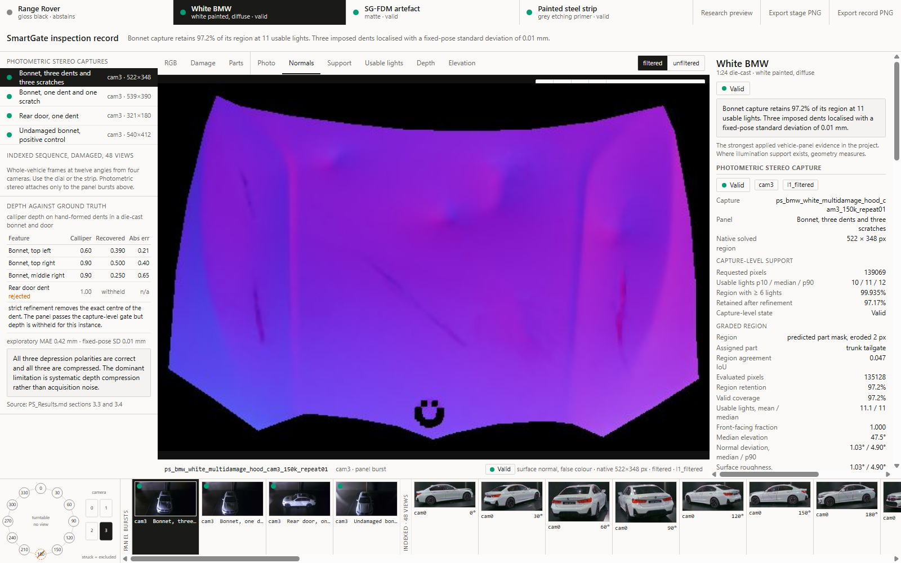

# SmartGate inspection viewer

An interactive viewer for the results of **SmartGate**, a model-scale vehicle
inspection rig built for an MSc thesis at Imperial College London. The rig
combines RGB damage segmentation, car-part segmentation and calibrated
photometric stereo inside a twelve-light capture chamber, and fuses them into a
per-component inspection record. The distinguishing feature is a quality gate:
when the observed surface cannot support a geometric measurement, the system
withholds the depth value and records why, rather than reporting a number it
cannot defend. This viewer is where that behaviour becomes visible.

https://github.com/user-attachments/assets/9f96c7f7-01b2-4de8-a2b2-34f2b1fc7384

## Open it

Clone or download this repository, then open `index.html` in any browser. There
is no server, no build step and no network access. Every image is a local file.



Segmentation overlays in this viewer are from models trained on real-vehicle datasets (CarDD, DSMLR) running on 1:18 / 1:24 die-cast models, so they show the domain gap the thesis measured. After fine-tuning on 22 labelled rig images, damage segmentation reached 0.93 mask AP50 on held-out frames.

The page opens on the white BMW, the subject where the geometry gate returns
`valid`: the bonnet capture retains 97.2% of its region at eleven usable lights
of twelve, and three imposed dents are recovered with a fixed-pose standard
deviation of 0.01 mm.

## What you can do

- **Four subjects.** The white BMW and a gloss-black Range Rover, plus two
  controlled targets: a 3D-printed damage artefact and a painted steel strip.
- **Turntable dial.** Twelve indexed positions at 30 degree intervals. Click a
  position or drag the ring to rotate. Arrow keys step through views, and up and
  down rotate the platform with wrap-around.
- **Nine layers.** Photograph, damage overlay and part masks, then the
  photometric-stereo fields: surface normals, illumination support, usable-light
  count, depth and elevation. Layers share one viewport, so switching between
  them holds the same region in place.
- **Zoom to eight times**, shared across layers, so an RGB frame and a normal
  map can be compared at the same magnification.
- **Confidence-threshold slider.** A sensitivity analysis over the recorded
  operating points. The declared operating point is 0.30; raising the threshold
  shows how the clean and damaged sequences separate.
- **Per-part records.** Each component carries its RGB evidence, its geometry
  state under a four-state taxonomy of valid, partial, invalid and not
  attempted, and the verbatim reason where depth was withheld.

## What is here, and what is not

This repository contains the viewer and its frozen data bundle. Everything in
it is the author's own work: chamber captures, solver outputs and generated
plots.

Not included, deliberately:

- **Datasets.** Model training used CarDD for damage segmentation, the DSMLR
  car-parts dataset and CrashCar101 for component segmentation. These are
  distributed by their own authors under their own terms and are not
  redistributed here.
- **Model checkpoints.** Excluded by size.
- **Raw captures and solver outputs.** Several gigabytes of light bursts,
  calibration products and intermediate results.

Because those inputs are absent, `viewer/build_viewer_data.py` cannot run in
this repository, and it will say so if invoked. It is published anyway, because
it is the script that generates the bundle from the stored experiment outputs
and it documents where every displayed value comes from. Nothing in the viewer
is computed at display time and no number was entered by hand; reading that file
is how you check that claim.

## Rebuilding the page

`index.html` is generated from the template and the JSON bundle. To rebuild it:

```
python viewer/build_index.py
```

This needs only [Pillow](https://python-pillow.org/). It re-inlines the thirteen
JSON files into `viewer/index.template.html` and rewrites `index.html`. The
JSON is embedded rather than fetched because browsers block `fetch` on
`file://`, which is also why the viewer works with no server.

## Known limitation

The in-page **Export stage PNG** and **Export record PNG** buttons fail when the
page is opened from `file://`, reporting a tainted-canvas error. This is a
browser security rule rather than a fault in the page: reading a `file://` image
back out of a canvas is blocked, and an SVG carrying a `foreignObject` taints
the canvas in Chrome at any origin. Take a screenshot instead. Everything else
works from `file://`.

## Scope

Results are model-scale, on 1:18 and 1:24 die-cast subjects under controlled
chamber lighting. Millimetre errors measured at that scale do not transfer to a
full-size vehicle by direct multiplication. Gloss-black panels fail the geometry
gate and release no depth; that is the designed behaviour of the quality gate
and one of the thesis's findings, not a defect in the viewer.

This is a research demonstrator accompanying a thesis. It is not a product.

## Licence

Code is released under the MIT Licence; see `LICENSE`.

Photographs, reconstructions and figures under `viewer_data/` are the author's
own work and are released under
[CC BY 4.0](https://creativecommons.org/licenses/by/4.0/).

## Citation

Mahmoud Eletreby, *SmartGate: Calibrated Photometric Stereo and RGB
Segmentation Fusion for Vehicular Damage Inspection*, MSc thesis, Department of
Electrical and Electronic Engineering, Imperial College London, 2026.
